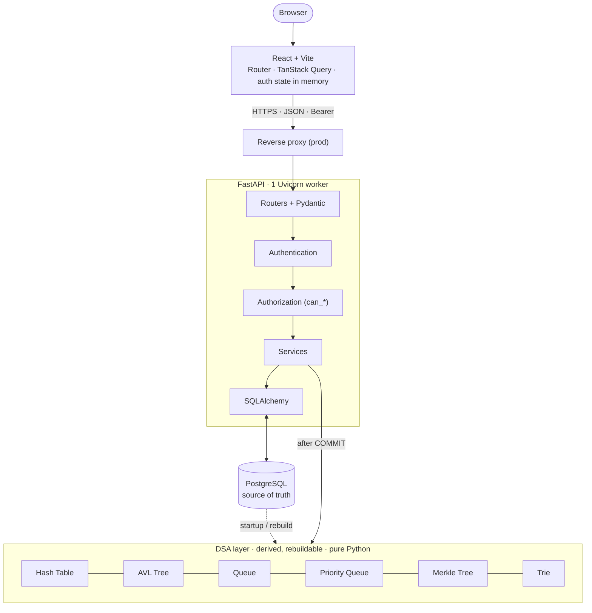
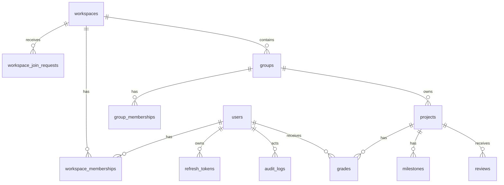

# NexaVault: Master Development Plan

A departmental academic workspace and project management platform, rebuilt from scratch (MeshVault is a reference for ideas only; no code is reused).

**Targets:** ~500 regular users, 1000+ registered. One backend process and one PostgreSQL database are enough. Smoothness comes from good queries, indexes, small payloads, and client-side caching.

---

## 1. What We Are Building

```
User → Workspace → Group → Project → Milestones / Reviews / Grades
```

Group numbers are unique **per workspace** only (Group 11 can exist in Workspace A and B). A user must never see data from a workspace they don't belong to. This is enforced by **database constraints** and **backend authorization**, never by the UI.

| Role | Can do |
|---|---|
| `STUDENT` (default on register) | Request to join workspaces, work on own group's projects and milestones, request reviews, view own grades |
| `STAFF` (promoted by a trusted script, not self-selected) | Create workspaces, approve join requests, manage groups, view all projects, take reviews, grade, view audit log |

Inside a workspace a member is `OWNER`, `STAFF`, or `STUDENT` (stored on the membership). Owners manage settings and staff.

**Authentication** = "who are you?" (login, token). **Authorization** = "are you allowed to do this?" (checked on every request against the specific object). Hiding a button in React is not security.

---

## 2. Tech Stack

| Layer | Choice | Why |
|---|---|---|
| Frontend | React, Vite, JavaScript/JSX, React Router, TanStack Query, CSS Modules, Lucide | Fast dev loop, client-side routing, server-state caching |
| Backend | Python, FastAPI, Pydantic v2, SQLAlchemy 2.0 (**sync**), Alembic, Uvicorn | Typed validation, auto docs (`/docs`), simple to debug |
| Database | PostgreSQL | Strongly related data, constraints, transactions, full-text + trigram search, `SKIP LOCKED` |
| Auth | PyJWT, `argon2-cffi` (Argon2id), HttpOnly refresh cookie | Short-lived access token + rotating refresh token |
| Config | pydantic-settings, `.env`, `.env.example` | Typed config, fails at startup if invalid |
| Quality | pytest, Vitest, React Testing Library, Ruff, ESLint, Prettier, GitHub Actions | Tests and lint on every PR |
| Runtime | Docker (Compose), Caddy/nginx reverse proxy in production | Reproducible environments, HTTPS |
| Background work | FastAPI `BackgroundTasks` (emails, checkpoints) | Enough for this scale |
| Dev email | Mailpit | Fake local inbox for verification/reset emails |

**Why PostgreSQL:** data is relational and rule-heavy (User ↔ Membership ↔ Workspace ↔ Group ↔ Project ↔ Grade). We need foreign keys, per-workspace uniqueness, and atomic multi-step changes. Postgres also covers search and queue locking, so no extra services are needed.

**Principle:** add infrastructure only when profiling shows a real problem.

---

## 3. Architecture



**Request flow:** Router → authentication dependency → authorization (`can_*`) → service → SQLAlchemy → PostgreSQL → response schema.
Routers stay thin; business logic lives in services so it can be tested without HTTP.

**Modular monolith:** one backend, one deployable, clear internal modules. REST + JSON, OpenAPI docs at `/docs`.

---

## 4. Database

**Conventions:** UUID primary keys (not guessable, but never a substitute for authorization); `timestamptz`; index every foreign key; soft delete (`deleted_at`) for workspaces, groups, projects; unique index on `lower(email)`.

| Table | Purpose / key rules |
|---|---|
| `users` | Email (unique, case-insensitive), `password_hash`, `role` (STUDENT/STAFF), `email_verified_at`, `is_active` |
| `refresh_tokens` | **Hashed** token, `family_id`, `expires_at`, `revoked_at`. Supports rotation and reuse detection |
| `email_tokens` | One-time hashed tokens for email verification and password reset |
| `workspaces` | Name, description, `created_by`, soft delete |
| `workspace_memberships` | `(workspace_id, user_id)` unique; `role` OWNER/STAFF/STUDENT |
| `workspace_join_requests` | Status PENDING/APPROVED/REJECTED; **partial unique index** allows one PENDING per user per workspace |
| `groups` | `UNIQUE (workspace_id, group_number)` |
| `group_memberships` | Stores `workspace_id` too, with composite FKs to `groups` and `workspace_memberships`. `UNIQUE (workspace_id, user_id)` = one group per student per workspace, enforced by the DB |
| `projects` | `workspace_id`, `group_id`, title, description, status, `progress_percent` (0–100, check constraint; derived from milestones, stored for fast lists) |
| `milestones` | `project_id`, title, due date, status, position |
| `reviews` | `project_id`, `reviewer_id` (null until claimed), `status`, `priority`, `created_at`. Partial index on pending reviews |
| `grades` | `project_id`, `student_id`, score with `0 ≤ score ≤ max_score`, `graded_by` |
| `audit_logs` | Append-only: actor, action, entity, workspace, details (old/new values, never secrets), `entry_hash` |
| `audit_merkle_roots` | Checkpoint roots over ranges of audit log ids |

Other indexes: `(workspace_id, status)` and `(workspace_id, progress_percent)` on projects; GIN full-text and trigram on project title/description.



Multi-step changes (e.g. approving a join request = update request + create membership + audit entry) run in **one transaction**.

---

## 5. Authentication & Authorization

### Authentication flow

```
Login form → POST /api/auth/login → verify Argon2id hash
  → access token (JWT, ~15 min, returned in JSON, kept in memory)
  → refresh token (random, ~7 days, HttpOnly + Secure + SameSite cookie, path /api/auth)
```

- **Page reload:** memory is empty → one silent `POST /api/auth/refresh` restores the session.
- **Rotation:** every refresh issues a new refresh token and revokes the old one. If a revoked token is reused, revoke the whole family and force re-login.
- **JWT claims:** `sub`, `exp`, `iat` only. **No roles inside the token.** Permissions are looked up in the database on each request, so removed members lose access immediately.
- **No localStorage:** any script on the page (XSS or a bad npm package) can read it. Memory plus an HttpOnly cookie avoids that.
- **Other endpoints:** register, verify-email, logout (revokes token, frontend clears query cache), forgot/reset password (one-time hashed tokens; reset revokes all sessions; same response whether or not the email exists), `GET /users/me`.
- **Rate limiting** on login, register, forgot-password, refresh (in-process counters are fine with one worker).

### Authorization

All permission rules live in `app/authorization/` as functions taking real objects loaded from the DB:

`can_view_workspace`, `can_manage_workspace`, `can_view_group`, `can_manage_group`, `can_view_project`, `can_edit_project`, `can_delete_project`, `can_request_review`, `can_review_project`, `can_modify_grade`, `can_view_grade`

Rules:
- **No role checks in routers.** Routers and services call `can_*` only.
- **Derive the workspace from the object**, never trust a `workspace_id` or `student_id` from the request body.
- **Filter list queries in SQL** (`WHERE workspace_id IN (user's workspaces)`), not in Python afterward.
- **IDOR/BOLA defense:** a valid token is not enough. If Student A changes `/projects/abc` to another group's project id, `can_view_project` must refuse. Return **404** for objects the user shouldn't know exist.
- Request schemas list exactly the fields a client may set (no `role` or `progress_percent` injection).

---

## 6. DSA Layer

> PostgreSQL is the source of truth. DSA structures are **derived, disposable, and rebuildable**. Nothing important exists only in Python memory.

| Class | Structure | Job in NexaVault | Complexity | PostgreSQL equivalent |
|---|---|---|---|---|
| `ProjectSearchIndex` | Hash table (own implementation, chaining, resize at ~0.75 load) | Project summary lookup by id | Avg O(1), worst O(n) | Primary-key index |
| `ProgressAVLTree` | AVL tree, key `(progress, project_id)`, one per workspace | Range ("40–70%"), min/max, ordered progress | O(log n); range O(log n + k) | B-tree on `(workspace_id, progress_percent)` |
| `ReviewQueue` | FIFO queue (linked list / circular buffer) | First-come-first-served review view | O(1) enqueue/dequeue | `ORDER BY created_at` |
| `PriorityReviewQueue` | Binary heap, key `(-priority, created_at, id)`, lazy deletion | Most urgent review first | Push/pop O(log n), peek O(1), build O(n) | `ORDER BY priority DESC, created_at` |
| `AuditMerkleTree` | Merkle tree over audit `entry_hash` values | Detect tampering with audit history | Build O(n); proof/verify O(log n) | None |
| `ProjectTrie` | Trie, one per workspace | Title prefix autocomplete | Insert O(L); prefix O(P + k) | Prefix `LIKE` / `pg_trgm` |

**Rules**
1. `backend/dsa/` is **pure Python**: no FastAPI or SQLAlchemy imports, standard library only.
2. Structures store ids and plain values. A sync service (outside `dsa/`) connects them to the DB.
3. **Startup:** build from PostgreSQL. **On write:** commit to PostgreSQL first, then update structures. If the update fails, mark the structure dirty and rebuild.
4. **Dirty or rebuilding structure:** serve the SQL result instead. Never serve stale data.
5. A `threading.Lock` guards mutations. The backend runs **one Uvicorn worker** (documented limitation; multiple workers would hold diverging copies).
6. Diagnostics: `/api/dsa/stats` (sizes, AVL height, load factor, last rebuild), `/api/dsa/rebuild`, Merkle verify/proof endpoints.

**Review assignment is always SQL.** `claim-next` runs in one transaction: pick the best pending review with `ORDER BY priority DESC, created_at ASC`, lock it with `FOR UPDATE SKIP LOCKED`, set reviewer and status, write an audit entry, commit. Two staff members can never get the same review. The Python queues are a derived view.

**Merkle tree and audit logs:** audit rows are written inside the same transaction as the action. A checkpoint job builds a Merkle tree over new entries and stores the root in `audit_merkle_roots`. Rebuilding and comparing roots detects edited or deleted rows. *Limitation:* someone who can edit both logs and roots can defeat it; publish roots elsewhere for real protection.

**Search split**

| Need | Tool |
|---|---|
| Exact lookup | Hash table (PK fallback) |
| Prefix autocomplete | Trie (SQL prefix fallback) |
| Word search | PostgreSQL full-text (`tsvector` + GIN) |
| Fuzzy/typos | `pg_trgm` |
| Progress range | AVL tree (SQL fallback) |

All search results are filtered by what the user may see. The project's academic value is honest comparison: write tests that DSA results equal SQL results on random data, and benchmark both on 10k generated projects (including where PostgreSQL wins).

---

## 7. Performance & Security Principles

**Performance (engineering targets, not guarantees)**

| Area | Target (p95) |
|---|---|
| Initial load | Usable UI < 2 s |
| Login | < 700 ms (includes deliberate Argon2id cost) |
| API read / write | < 150 ms / < 300 ms server time |
| Search / autocomplete | < 100 ms server time |
| Cached navigation | Feels instant |

- **Backend:** index foreign keys and filters, paginate every list (default 20, max 100), return minimal payloads, avoid N+1 (eager loading; assert query counts in tests), use SQLAlchemy connection pooling, keep transactions short, send email in `BackgroundTasks`.
- **Frontend:** TanStack Query caching with per-resource `staleTime`, route-level code splitting (`React.lazy`), skeleton loading states, debounced search (~200 ms), optimistic updates only for low-risk actions (milestone toggle; never grades, permissions, deletes), stable list keys.
- **Measure first:** use `EXPLAIN ANALYZE` and the browser network tab. Don't optimize without numbers.

**Security**
- Argon2id passwords; HTTPS in production; secure headers (HSTS, CSP, `nosniff`, `Referrer-Policy`, frame-ancestors).
- Same-origin deployment (frontend + `/api` behind one proxy) keeps CORS and cookies simple. Dev uses the Vite proxy. Never `*` with credentials.
- CSRF: refresh cookie is `SameSite` and path-restricted; require a custom header and check `Origin` on `/auth/refresh` and `/auth/logout`. All other endpoints use a Bearer header.
- XSS: rely on React escaping, never `dangerouslySetInnerHTML` with user content, keep dependencies few.
- SQL injection: parameterized SQLAlchemy only. Validate all input with Pydantic.
- Secrets only in environment variables, `.env` is git-ignored, `.env.example` is committed. If a secret is committed, rotate it.
- Logging: structured JSON with a `request_id`. **Never log** passwords, tokens, secrets, or unnecessary personal data.
- Errors: one format everywhere, with `error.code`, `message`, `details`, `request_id`. Never leak stack traces or SQL.

| Case | Status |
|---|---|
| Validation | 422 |
| Not authenticated | 401 |
| Forbidden / hidden | 403 / 404 |
| Conflict (e.g. duplicate group number) | 409 |
| Rate limited | 429 |
| Unexpected | 500 (generic message; details in logs) |

---

## 8. Repository Structure

```
NexaVault/
├── frontend/
│   ├── src/
│   │   ├── components/   # reusable UI (Button, TextField, Skeleton)
│   │   ├── pages/        # one per screen
│   │   ├── layouts/      # AuthLayout, AppLayout
│   │   ├── routes/       # route config, ProtectedRoute, lazy imports
│   │   ├── queries/      # TanStack Query hooks per resource
│   │   ├── services/     # API client (attaches token, handles refresh)
│   │   ├── hooks/  store/  utils/  styles/  assets/
│   └── tests/
├── backend/
│   ├── app/
│   │   ├── core/           # config, security, logging, errors, rate limiting
│   │   ├── db/             # engine, session, base
│   │   ├── models/         # SQLAlchemy tables
│   │   ├── schemas/        # Pydantic request/response shapes
│   │   ├── routers/        # thin HTTP endpoints
│   │   ├── services/       # business logic + transactions
│   │   ├── dependencies/   # get_db, get_current_user
│   │   ├── authorization/  # ALL can_* rules
│   │   └── main.py
│   ├── dsa/                # pure Python structures
│   ├── scripts/            # seed data, promote-to-staff, benchmarks
│   ├── tests/              # dsa/ authorization/ api/ integration/
│   └── migrations/         # Alembic
├── docs/                   # runbook, performance notes, DSA report
├── .github/workflows/      # CI
├── docker-compose.yml
├── README.md
├── .gitignore
└── .env.example
```

State rules: server data lives in TanStack Query; everything else starts as `useState`; the access token lives in memory only; Zustand only if two distant components truly need shared client state. Routers never contain queries or permission logic; models never contain business rules; never return ORM models directly (always a schema).

---

## 9. Development Plan

Eight phases in dependency order. Write **tests as you build each feature**, not at the end. The `dsa/` package is pure Python, so you can build it any time after Phase 1 as a break from web work; it is integrated in Phase 6.

### Phase 1: Project Setup
**Build**
- Repo, `.gitignore` (with `.env`), `.env.example`, GitHub branch protection and CI skeleton
- Frontend: Vite + React, Router, CSS tokens, ESLint/Prettier/Vitest, **static Login page** (layout, branding, email/password, show/hide, validation, loading and error states, responsive; fake submit with a timeout)
- Backend: FastAPI app, `/api/health`, pydantic-settings, logging, standard error format, Ruff, pytest
- Compose file with PostgreSQL (named volume) + Mailpit
- SQLAlchemy engine/session, Alembic, first migration applied

**Learn first:** Git basics, components/props/state, HTTP and status codes, tables/keys/migrations, Docker container vs volume.
**Done when:** `npm run dev`, `uvicorn`, `docker compose up -d`, `alembic upgrade head`, lint, and tests all work from a fresh clone.

### Phase 2: Authentication & Authorization
**Build**
- Tables: `users`, `refresh_tokens`, `email_tokens`
- Auth endpoints (section 5): register, verify, login, refresh with rotation and reuse detection, logout, forgot/reset, `me`, rate limiting
- `authorization/` module and the dependency pattern (first rule: only STAFF create workspaces)
- `audit_logs` table and one `audit_service` function used inside the caller's transaction
- Connect Login UI: API client, in-memory auth state, silent refresh on load, `ProtectedRoute`, TanStack Query provider, dashboard shell, logout clears cache

```
Login UI → POST /auth/login → access token (memory) + refresh cookie → GET /users/me → protected routes → Dashboard
```

**Learn first:** hashing vs encryption, JWT contents, HttpOnly/Secure/SameSite, authentication vs authorization, IDOR.
**Done when:** login, reload (still logged in), and logout all work; DevTools shows no token in localStorage and an HttpOnly refresh cookie; tests cover wrong password, expired token, reused refresh token, rate limit, and reset revoking sessions; DB holds no plaintext passwords or tokens.

### Phase 3: Workspaces & Groups
**Build**
- Tables: `workspaces`, `workspace_memberships`, `workspace_join_requests`, `groups`, `group_memberships` (composite FKs)
- Create/list/view/discover workspaces, join request → approve/reject (one transaction + audit), remove member
- Group CRUD and member management
- Matching `can_*` functions, pages with skeleton/empty/error states

**Learn first:** foreign keys and joins, composite keys, partial unique indexes, transactions, pagination.
**Done when:** Group 11 exists in two workspaces; a student cannot be in two groups of one workspace or join a group without workspace membership (DB-level tests); non-members and students are refused on every staff action.

### Phase 4: Projects & Milestones
**Build**
- Tables: `projects`, `milestones`, with indexes
- Project CRUD with filters, pagination, soft delete; milestone CRUD and reorder
- `progress_percent` recalculated from milestones **in the same transaction**
- UI: project list/detail, milestone toggle with optimistic update and rollback

**Learn first:** N+1 and eager loading, indexes for filters, denormalization trade-offs, optimistic updates.
**Done when:** Student A cannot read or edit Student B's project; list endpoint uses a bounded number of queries (test); progress is always consistent with milestones (including 0 milestones and deletions).

### Phase 5: Reviews & Grading
**Build**
- Tables: `reviews`, `grades`
- Request review, list, `claim-next` (`SKIP LOCKED`, section 6), complete, cancel
- Grade upsert (per student) with audit entries holding old/new score; students see only their own
- Staff review queue UI

**Learn first:** row locking, race conditions, check constraints, why grade changes need audit history.
**Done when:** two simultaneous claims receive different reviews (concurrency test); students cannot claim, complete, or modify grades; every grade change writes an audit row.

### Phase 6: Search & DSA
**Build**
1. PostgreSQL search first: full-text (GIN), `pg_trgm` fuzzy, SQL prefix autocomplete, debounced search box
2. `backend/dsa/` (if not already built): hash table → trie → queue → priority queue → AVL → Merkle, each with edge-case tests and documented complexity
3. Integration: build at startup, update after commit, dirty flag + SQL fallback, `/api/dsa/*` endpoints, Merkle checkpointing and verification, benchmark script

**Learn first:** Big-O, hash collisions, AVL rotations, heap sift up/down, what a Merkle root proves, derived data vs source of truth.
**Done when:** search never leaks other workspaces' projects; DSA results equal SQL results on random data; killing and restarting the app rebuilds identical results; editing an audit row makes Merkle verification fail; benchmark report written.

### Phase 7: Testing & Optimization
**Build**
- Fill every gap in the security test list below
- Secure headers, CORS review, `pip-audit`/`npm audit`, error boundary and error-state review
- Seed realistic data (1000 users, 10k projects), measure against section 7 targets, fix only measured bottlenecks (indexes, N+1, payload size, bundle size, re-renders)

**Security tests that must pass**
- Student A → Student B's project (read and edit)
- Student → anything in another workspace; staff of A → objects in B
- Student modifies or reads another student's grade
- Student claims/completes a review or approves a join request
- Forged `role`/`workspace_id` in request bodies
- Expired, tampered, or missing JWT; reused refresh token; login rate limit
- Removed member with a still-valid access token loses access immediately
- List endpoints return only permitted objects

**Done when:** CI is green and before/after performance numbers are recorded in `docs/`.

### Phase 8: Docker & Deployment
**Build**
- Production images for backend and frontend; production Compose or host config
- Reverse proxy with HTTPS serving the static build and routing `/api` (same origin)
- Environment secrets from the host; Alembic migrations run as a deploy step before the new backend starts; one Uvicorn worker
- Automated `pg_dump` backups copied off the server, **one tested restore**, short runbook in `docs/`

**Learn first:** image vs container vs volume, environment variables, HTTPS and reverse proxy.
**Done when:** a teammate can deploy from the runbook; the refresh cookie is `Secure`; a restored backup works and DSA structures rebuild automatically.

---

## 10. Deployment, Backups & Scaling

```
Internet → HTTPS → Reverse proxy ─┬─ static frontend files
                                  └─ /api → FastAPI container (1 worker) → PostgreSQL (volume or managed)
```

- **Dev:** Vite dev server + local Uvicorn + Compose (Postgres + Mailpit). Dockerize the apps last.
- **Prod:** built static frontend, no reload, no debug output, secrets from the host.
- **Backups:** daily `pg_dump`, stored off-server, keep ~7 daily + 4 weekly + an end-of-semester snapshot. A Docker volume is persistence, **not** a backup. Restore into a scratch database before launch and monthly after.
- **Scaling path:** profile first. Add indexes and query fixes before anything else. Moving the DSA layer off in-process memory is the only change that would be needed before running multiple workers; at 500 users it isn't.

---

## 11. Team Workflow

- `main` is protected: PR + passing CI required.
- Branches: `feature/…`, `fix/…`. Small commits with imperative messages.
- One feature per PR with what/why/how-to-test. At least one reviewer checks authorization, tests, and no secrets.
- Track work as GitHub issues (one per feature or bug) on a simple To do / Doing / Review / Done board.
- CI on every PR: Ruff, ESLint, Prettier check, pytest (with Postgres service), Vitest, dependency audit.
- Update this README in the same PR whenever a decision changes.

---

## 12. What NOT To Do

- Don't store important data only in Python memory, and don't use DSA structures as the database.
- Don't update DSA structures before the DB commit.
- Don't run multiple Uvicorn workers while DSA state is in memory.
- Don't put tokens in localStorage or roles/permissions in the JWT.
- Don't trust frontend authorization or scatter permission checks (use `authorization/`).
- Don't put business logic in route handlers or return ORM models directly.
- Don't return unpaginated lists or build SQL with string formatting.
- Don't use optimistic UI for grades, permissions, or deletes.
- Don't log secrets or commit `.env`.
- Don't force DSA features that don't belong in the product (no Knapsack or Sprint Optimizer).
- Don't add infrastructure or dependencies without a measured need, and don't optimize before measuring.
- Don't skip restoring a backup "because it probably works."

---

## 13. Open Decisions

| Question | Suggested default | Decide in |
|---|---|---|
| How are STAFF accounts created? | Register as STUDENT; script promotes trusted users | Phase 2 |
| Restrict registration to institutional email domain? | Yes, if the department has one | Phase 2 |
| Can unverified users log in? | Yes, but cannot join workspaces | Phase 2 |
| Can students see other groups' names? | No, own group only | Phase 3 |
| Multiple projects per group? | Schema allows it; UI may start with one | Phase 4 |
| Grades per student or per group? | Per student; UI can apply one score to the whole group | Phase 5 |
| Default review order in the UI? | Priority queue with FIFO tie-break | Phase 5 |
| Merkle checkpoint frequency? | Hourly plus manual trigger | Phase 6 |
| Hosting target? | Decide before Phase 8 | Phase 7 |
