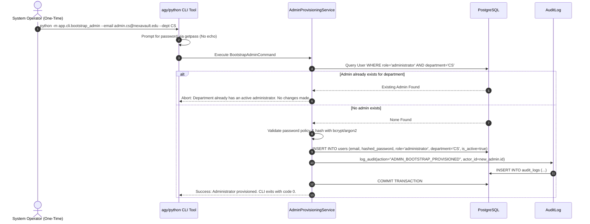
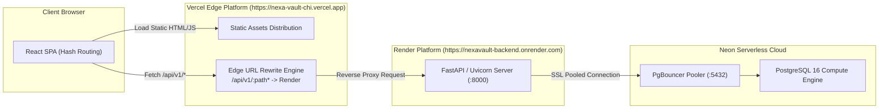

# NexaVault — Formal ADR 2.0 Review & Phase 1 Readiness Report

**Role**: Principal Software Architect  
**Date**: 2026-11-21  
**Status**: FORMAL ARCHITECTURE EVALUATION & READINESS SIGN-OFF  
**Document Reference**: `docs/architecture/ADR-2.0-REVIEW-AND-PHASE-1-READINESS.md`  

---

## Executive Summary

This document establishes the formal architecture evaluation of all nine Architecture Decision Records (ADRs) defined in `ADR-REVISION-2.0.md`, resolves the administrator provisioning lifecycle, and evaluates the production deployment topology across Vercel, Render, and Neon.

---

# PART 1 — Formal Review of All ADR Decisions

Every ADR in `ADR-REVISION-2.0.md` has been evaluated across seven criteria:
1. Architectural correctness.
2. Consistency with actual repository implementation.
3. Consistency with NexaVault's academic workflows.
4. Security implications.
5. Database integrity.
6. Migration complexity.
7. Operational feasibility for a single-deployable platform.

---

### ADR-001: Architectural Style
* **Proposed Decision**: Hexagonal Architecture + Domain-Driven Design (DDD) + Event-Driven Modular Monolith + Selective CQRS in a single deployable backend. Forbids microservices, Kubernetes, and Kafka.
* **Status**: **ACCEPTED**
* **Technical Justification**:
  * *Correctness & Feasibility*: University department systems do not have Google-scale distributed throughput requirements; they have strict relational integrity requirements. A modular monolith preserves ACID consistency across course enrollments, milestone submissions, and grade entries without distributed transaction overhead (2PC/Sagas).
  * *Repository Consistency*: Currently, over 7,500 LOC are concentrated in route controllers. Decoupling into domain aggregates, use case ports, and infrastructure adapters resolves controller bloat while maintaining a single Uvicorn/FastAPI process.
* **Required Amendments**: None.

---

### ADR-002: Administrator and Department Governance
* **Proposed Decision**: Default Administrator role is strictly department-scoped. `NULL` department grants zero access (fail-closed); untagged workspaces are hidden; administrators cannot grade or publish marks; platform super-admin deferred.
* **Status**: **ACCEPTED WITH CONDITIONS**
* **Technical Justification**:
  * *Security & Tenancy*: Closes a major vulnerability in `app/core/permissions.py:94` and `admin.py:105-107` where `department IS NULL` leaked workspaces to all department admins.
  * *Academic Separation of Concerns*: Department administrators manage operational infrastructure (staff assignment, workspace archival, user status) but must never alter academic grades or evaluation outcomes.
* **Required Conditions / Amendments**:
  1. **Remediation of Untagged Workspaces**: During migration, any legacy workspace where `department IS NULL` must be assigned an explicit department code or quarantined into an inactive state.
  2. **Audit Attribution**: Any department administrator assignment or revocation of staff must record both the administrator's ID and department tag in the audit log.

---

### ADR-003: Transactional Business Operations
* **Proposed Decision**: Synchronous atomic transactions for group changes, submission creation, review claiming, evaluation scoring, result release, grade corrections, and staff/admin permission updates. Pessimistic row locking (`SELECT ... FOR UPDATE`) preserved for claiming.
* **Status**: **ACCEPTED**
* **Technical Justification**:
  * *Data Integrity*: Core academic evaluations must never be delegated to asynchronous eventually-consistent workers. If an evaluation commits, the `Review` header, all individual `ResultEntry` rows, and the mandatory audit log must commit together atomically.
  * *Concurrency*: `reviews.py:126` already implements `with_for_update()` on submission claiming. Preserving this in the application use case prevents race conditions between simultaneous evaluators.
* **Required Amendments**: None.

---

### ADR-004: Transactional Outbox and Event Delivery
* **Proposed Decision**: PostgreSQL-backed `outbox_events` table with worker claiming via `SELECT FOR UPDATE SKIP LOCKED`, exponential retry backoff, consumer idempotency log, and at-least-once delivery. Asynchronous side effects (notifications, reporting) decoupled from primary transactions.
* **Status**: **ACCEPTED WITH CONDITIONS**
* **Technical Justification**:
  * *Operational Feasibility*: Eliminates the operational burden of managing RabbitMQ or Kafka in a single-container or Render-hosted deployment. PostgreSQL provides native transactional atomicity between business state mutations and event emission.
* **Required Conditions / Amendments**:
  1. **Dead-Letter State**: After 5 failed attempts with exponential backoff (`10s`, `20s`, `40s`, `80s`, `160s`), the event must transition to `DEAD_LETTER` status and generate a high-priority system error log.
  2. **Crash Recovery Threshold**: An event in `PROCESSING` status without a heartbeat for $> 5$ minutes must be reclaimed automatically to recover from worker container restarts.
  3. **Purge Policy**: Completed events (`status = 'PROCESSED'`) must be pruned or archived periodically (e.g. 14-day retention) to prevent table bloat on Neon storage compute.

---

### ADR-005: Audit and Compliance
* **Proposed Decision**: Two-tier audit architecture (mandatory in-transaction audit for sensitive operations vs. asynchronous outbox activity for non-critical feeds). Append-only ledger. Merkle root checkpointing deferred.
* **Status**: **ACCEPTED**
* **Technical Justification**:
  * *Integrity & Honesty*: Acknowledges the reality that `AuditMerkleRoot` in `app/models/audit.py:48` has zero operational calculation code. Deferring Merkle trees avoids false security claims.
  * *Sanitization*: Preserves the recursive data scrubbing in `app/services/audit_service.py` that masks passwords, tokens, API keys, and JWTs with `[REDACTED]`.
* **Required Amendments**: None.

---

### ADR-006: Identity, Authentication & Session Security
* **Proposed Decision**: Immutable user IDs as JWT subjects; silent password truncation eliminated; Argon2id migration path prepared; refresh token rotation with SHA-256 hash storage and reuse detection.
* **Status**: **ACCEPTED WITH CONDITIONS**
* **Technical Justification**:
  * *Security*: Storing mutable email in JWT `sub` breaks user identity if emails are updated. Truncating passwords at 72 bytes silently violates user password expectations.
* **Required Conditions / Amendments**:
  1. **Backwards Compatibility**: During Phase 1, the JWT decoder must accept both integer user ID string and legacy email in the `sub` claim until all active 24-hour tokens expire.
  2. **Token Storage Alignment**: Conditioned on Part 3 deployment topology analysis below.

---

### ADR-007: Group Membership and Workspace Enrollment
* **Proposed Decision**: Domain invariant: A student may belong to only one active project group per workspace, while participating in different groups across different workspaces. Relational model evolves to include `workspace_id` in group membership.
* **Status**: **ACCEPTED WITH CONDITIONS**
* **Technical Justification**:
  * *Domain Reality*: `GroupMembership.user_id` having a global `UNIQUE` constraint in `app/models/group.py:38` is an acknowledged system defect that contradicts academic reality.
* **Required Conditions / Amendments**:
  1. **Data Pre-Validation**: Before applying the unique index migration in Phase 4, a verification script must confirm that existing student groups do not have orphan memberships or contradictory foreign keys.
  2. **Group Deletion Cascade**: Group soft-deletion logic must preserve submission version history and frozen rosters intact.

---

### ADR-008: Bounded Context Ownership
* **Proposed Decision**: 9 strictly separated contexts (Identity & Access, Department Governance, Workspace Management, Group Management, Assessment & Submission, Evaluation & Results, Audit & Compliance, Notifications, Search & Read Projections). Cross-context direct ORM traversals forbidden.
* **Status**: **ACCEPTED**
* **Technical Justification**:
  * *Decoupling*: Enforcing that contexts interact only via application use cases and primitive IDs (e.g. `workspace_id: str`) eliminates circular dependencies and allows unit testing of domain models in isolation.
* **Required Amendments**: None.

---

### ADR-009: Selective CQRS
* **Proposed Decision**: Command handlers enforce invariants via aggregates; read operations (Results Dashboard, Review Queue, Smart Search, CSV Export) query optimized SQL projections directly. Single PostgreSQL database.
* **Status**: **ACCEPTED**
* **Technical Justification**:
  * *Performance without Complexity*: Assembling the Results Dashboard with dynamic review round headers via full aggregate hydration causes severe ORM bloat. Direct SQL projections (using SQLAlchemy Core / select expressions) provide sub-10ms response times without requiring separate read databases.
* **Required Amendments**: None.

---

# PART 2 — Resolution of Administrator Provisioning

## 1. Principles
1. `JWT_SECRET` is mandatory in production; startup must fail immediately if `JWT_SECRET` is unset or equals the fallback key.
2. Initial administrator provisioning must be an **explicit, one-time operation**, never an automatic side effect of server reboot.
3. Existing administrator accounts and passwords must **never** be reset on application startup.
4. Passwords must **never** appear in application logs or console output.
5. Bootstrap credentials must **never** be hardcoded in source code or Alembic migration files.
6. The bootstrap mechanism must be idempotent, safe against duplicate execution, and automatically disabled once initial administrator provisioning is complete.

## 2. Proposed Implementation Architecture



### Proposed CLI Tool Specification (`backend/app/cli/bootstrap_admin.py`)
* Invoked via terminal: `python -m app.cli.bootstrap_admin --email <email> --name <name> --dept <dept_code>`
* Uses Python `getpass.getpass()` for password input (never passed via shell command line arguments to avoid shell history leakage).
* Checks if an administrator for that department already exists:
  * If yes: Exits with non-zero code and message: `[!] Aborted: Department administrator already provisioned.`
  * If no: Inserts user with `role="administrator"`, commits, records audit log, and prints `[+] Success: Administrator account provisioned.`
* **Automated Removal from `app/main.py`**:
  * Lines 85–138 (`bootstrap_administrators` hook) will be completely removed in Phase 1.
  * Alembic migration `h8i9j0k1l2m3_seed_default_administrators.py` will have hardcoded password insertion replaced with an idempotent no-op or removed from future baselines.

---

# PART 3 — Frontend & Backend Deployment Topology Resolution

## 1. Verified Deployment Topology

Based on codebase inspection of `vercel.json`, `docker-compose.yml`, `frontend/nginx.conf`, and `backend/app/core/config.py`:



### Verified Findings:
1. **Frontend Host**: Deployed on **Vercel** at `https://nexa-vault-chi.vercel.app`.
2. **Backend Host**: Deployed on **Render** at `https://nexavault-backend.onrender.com`.
3. **Database Host**: Deployed on **Neon Serverless PostgreSQL** with SSL pooled connections (`sslmode=require`, `prepare_threshold=None`).
4. **Vercel Rewrite Proxy**:
   * In `vercel.json`:
     ```json
     {
       "rewrites": [
         {
           "source": "/api/v1/:path*",
           "destination": "https://nexavault-backend.onrender.com/api/v1/:path*"
         },
         {
           "source": "/(.*)",
           "destination": "/"
         }
       ]
     }
     ```
   * From the browser's perspective, API requests directed to `/api/v1/*` are sent to `nexa-vault-chi.vercel.app` and proxied server-to-server to Render.
5. **CORS Configuration**:
   * `app/core/config.py:42-49` allows origins: `http://localhost:3000`, `http://localhost:5173`, and `https://nexa-vault-chi.vercel.app`.

## 2. Authentication Transport Resolution: Bearer Tokens vs. Cookies

### Analysis:
* While Vercel edge rewrites forward requests to Render, cross-platform cookie forwarding across edge proxies introduces edge failure modes:
  * Vercel proxy headers can strip or partition cookies if domain attributes do not match.
  * Direct API requests (e.g. during local development on `localhost:5173` connecting to `localhost:8000`) encounter cross-site cookie blocking under modern browser tracking prevention unless `SameSite=None; Secure` is used with public SSL.
* In contrast, the current client (`frontend/src/api/client.js:35`) attaches standard `Authorization: Bearer <token>` headers.

### Architectural Decision:
1. **Retain Bearer Authorization Header as Primary Access Transport**:
   * Short-lived JWT Access Tokens (15 minutes) passed via `Authorization: Bearer <token>` in application memory (React state / AuthContext).
2. **Introduce Secure Refresh Token Endpoint**:
   * A dedicated `POST /api/v1/auth/refresh` endpoint that accepts a hashed refresh token.
   * For the refresh token, use an `HttpOnly`, `SameSite=Lax`, `Secure` cookie when accessed via same-origin/Vercel rewrite, with fallback to JSON body refresh token for cross-origin local development.
3. **Automated 401 Session Interceptor**:
   * Update `frontend/src/api/client.js` to catch 401 Unauthorized responses, attempt one silent refresh, and if failed, clear session and dispatch an automatic logout event.

---

# PART 4 — Phase 1 Readiness Sign-Off

### Gate Verification Checklist:
* [x] **ADR Review Complete**: All 9 ADRs assigned definitive statuses with explicit technical conditions.
* [x] **Zero Code Modified**: Git working tree confirms zero application source code, models, or migrations were altered.
* [x] **Existing Tests Verified**: 132 tests passing on current baseline.
* [x] **Administrator Provisioning Policy Defined**: Replaces hardcoded credentials with explicit, idempotent CLI bootstrap tool.
* [x] **Deployment Topology Mapped**: Vercel rewrite proxy, Render backend, and Neon PostgreSQL confirmed.
* [x] **Phase 1 Implementation Sequence Finalized**: Foundation & Security Hardening (Outbox schema, secret enforcement, removing hardcoded admin) ready to execute upon approval.

---

**PHASE 0 FORMAL REVIEW CONCLUDED. READY FOR PHASE 1 IMPLEMENTATION UPON APPROVAL.**
