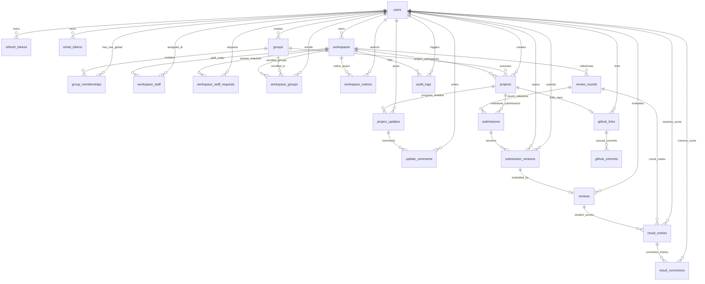

# NexaVault — Phase 0: Verified Current-State Database Map

**Verification Mode**: READ-ONLY STATIC & REPOSITORY CODE AUDIT  
**Date**: 2026-11-21  
**Target Persistence**: PostgreSQL 16 / Neon Serverless PgBouncer Pooler  
**Test Persistence**: SQLite in-memory (`sqlite:///:memory:`)

---

## 1. Verified Table & Schema Inventory

The persistence model consists of **20 database tables** defined in SQLAlchemy ORM (`backend/app/models/`) and versioned across **10 Alembic migrations** (`backend/alembic/versions/`).

| # | Table Name | SQLAlchemy Source File | Primary Key | Key Columns & Types | Nullability & Constraints | Status & Enum Model |
|---|---|---|---|---|---|---|
| 1 | `users` | `app/models/user.py:13` | `id` (Integer, Auto) | `email` (Str 255), `hashed_password` (Str 255), `full_name` (Str 255), `roll_number` (Str 100), `role` (Str 50), `department` (Str 100), `is_active` (Bool), `created_at` (Timestamptz) | `email` UNIQUE, `email` NOT NULL, `roll_number` NULLABLE (indexed), `department` NULLABLE (indexed) | Free-form String ("student", "staff", "administrator", "teacher") |
| 2 | `refresh_tokens` | `app/models/user.py:35` | `id` (Integer, Auto) | `user_id` (Int, FK), `token_hash` (Str 255), `expires_at` (Timestamptz), `created_at` (Timestamptz) | `user_id` NOT NULL (FK `users.id` CASCADE), `token_hash` UNIQUE NOT NULL | **Dormant model** (Zero operational routes) |
| 3 | `email_tokens` | `app/models/user.py:46` | `id` (Integer, Auto) | `user_id` (Int, FK), `token` (Str 255), `token_type` (Str 50), `expires_at` (Timestamptz), `created_at` (Timestamptz) | `user_id` NOT NULL (FK `users.id` CASCADE), `token` UNIQUE NOT NULL | **Dormant model** (Zero operational routes) |
| 4 | `groups` | `app/models/group.py:6` | `id` (Integer, Auto) | `name` (Str 255), `code` (Str 50), `created_by` (Int, FK), `is_deleted` (Bool), `created_at` (Timestamptz) | `code` UNIQUE NOT NULL, `created_by` NOT NULL (FK `users.id`), `is_deleted` DEFAULT FALSE | Soft delete boolean flag |
| 5 | `group_memberships` | `app/models/group.py:25` | `id` (Integer, Auto) | `group_id` (Int, FK), `user_id` (Int, FK), `joined_at` (Timestamptz) | `group_id` NOT NULL (FK `groups.id` CASCADE), `user_id` NOT NULL (FK `users.id` CASCADE), `uq_user_single_active_group` UNIQUE(`user_id`) | Active row = Member; Departure = Hard Row Delete |
| 6 | `workspaces` | `app/models/workspace.py:6` | `id` (String 100, PK) | `name` (Str 255), `description` (Text), `term` (Str 100), `department` (Str 100), `owner_id` (Int, FK), `is_open` (Bool), `is_archived` (Bool), `created_at` (Timestamptz) | `id` PK (custom/derived), `owner_id` NOT NULL (FK `users.id`), `department` NULLABLE (indexed), `term` NOT NULL | Lifecycle booleans (`is_open`, `is_archived`) |
| 7 | `workspace_staff` | `app/models/workspace.py:31` | `id` (Integer, Auto) | `workspace_id` (Str 100, FK), `user_id` (Int, FK), `role` (Str 50), `assigned_at` (Timestamptz) | `workspace_id` NOT NULL (FK `workspaces.id` CASCADE), `user_id` NOT NULL (FK `users.id` CASCADE), `uq_workspace_staff` UNIQUE(`workspace_id`, `user_id`) | String ("owner", "costaff") |
| 8 | `workspace_staff_requests` | `app/models/workspace.py:47` | `id` (Integer, Auto) | `workspace_id` (Str 100, FK), `requester_id` (Int, FK), `status` (Str 50), `created_at` (Timestamptz), `resolved_at` (Timestamptz) | `workspace_id` NOT NULL (FK `workspaces.id` CASCADE), `requester_id` NOT NULL (FK `users.id` CASCADE), `uq_workspace_staff_request` UNIQUE(`workspace_id`, `requester_id`) | String ("pending", "approved", "rejected") |
| 9 | `workspace_groups` | `app/models/workspace.py:64` | `id` (Integer, Auto) | `workspace_id` (Str 100, FK), `group_id` (Int, FK), `enrolled_by` (Int, FK), `enrolled_at` (Timestamptz) | `workspace_id` NOT NULL (FK `workspaces.id` CASCADE), `group_id` NOT NULL (FK `groups.id` CASCADE), `uq_workspace_group_enrollment` UNIQUE(`workspace_id`, `group_id`) | Enrollment row linking group to workspace |
| 10 | `workspace_notices` | `app/models/workspace.py:81` | `id` (Integer, Auto) | `workspace_id` (Str 100, FK), `author_id` (Int, FK), `title` (Str 255), `body` (Text), `image_url` (Text), `image_key` (Str 255), `thumbnail_url` (Text), `is_pinned` (Bool), `is_archived` (Bool), `created_at` (Timestamptz), `updated_at` (Timestamptz), `expires_at` (Timestamptz) | `workspace_id` NOT NULL (FK `workspaces.id` CASCADE), `author_id` NOT NULL (FK `users.id`), `expires_at` NOT NULL (indexed) | Pinned & Expiration logic (24h default) |
| 11 | `review_rounds` | `app/models/review.py:11` | `id` (Integer, Auto) | `workspace_id` (Str 100, FK), `title` (Str 255), `description` (Text), `order_index` (Int), `due_date` (Timestamptz), `max_score` (Numeric 6,2), `weight` (Numeric 5,2), `is_open` (Bool), `created_at` (Timestamptz) | `workspace_id` NOT NULL (FK `workspaces.id` CASCADE), `chk_round_max_score_positive` CHECK(`max_score >= 1.0`) | Active toggle (`is_open`) |
| 12 | `projects` | `app/models/project.py:13` | `id` (Integer, Auto) | `workspace_id` (Str 100, FK), `group_id` (Int, FK), `name` (Str 255), `description` (Text), `created_by` (Int, FK), `custom_progress` (Float), `progress_updated_at` (Timestamptz), `progress_updated_by` (Int, FK), `created_at` (Timestamptz) | `workspace_id` NOT NULL (FK `workspaces.id` CASCADE), `group_id` NOT NULL (FK `groups.id` CASCADE), `uq_workspace_group_project` UNIQUE(`workspace_id`, `group_id`) | Progress: derived or staff override |
| 13 | `project_updates` | `app/models/project.py:46` | `id` (Integer, Auto) | `project_id` (Int, FK), `author_id` (Int, FK), `content` (Text), `link` (Text), `created_at` (Timestamptz) | `project_id` NOT NULL (FK `projects.id` CASCADE), `author_id` NOT NULL (FK `users.id`) | Timeline milestone update |
| 14 | `update_comments` | `app/models/project.py:63` | `id` (Integer, Auto) | `update_id` (Int, FK), `author_id` (Int, FK), `content` (Text), `created_at` (Timestamptz) | `update_id` NOT NULL (FK `project_updates.id` CASCADE), `author_id` NOT NULL (FK `users.id`) | Threaded comment |
| 15 | `github_links` | `app/models/github.py:10` | `id` (Integer, Auto) | `project_id` (Int, FK, UNIQUE), `repo_url` (Str 500), `linked_by` (Int, FK), `linked_at` (Timestamptz), `last_synced_at` (Timestamptz) | `project_id` UNIQUE NOT NULL (FK `projects.id` CASCADE), `linked_by` NOT NULL (FK `users.id`) | 1-to-1 project GitHub binding |
| 16 | `github_commits` | `app/models/github.py:30` | `id` (Integer, Auto) | `github_link_id` (Int, FK), `commit_sha` (Str 100), `commit_message` (Text), `author_name` (Str 255), `committed_at` (Timestamptz) | `github_link_id` NOT NULL (FK `github_links.id` CASCADE), `commit_sha` NOT NULL | Synced commit record |
| 17 | `submissions` | `app/models/review.py:36` | `id` (Integer, Auto) | `project_id` (Int, FK), `round_id` (Int, FK), `created_at` (Timestamptz) | `project_id` NOT NULL (FK `projects.id` CASCADE), `round_id` NOT NULL (FK `review_rounds.id` CASCADE), `uq_project_round_submission` UNIQUE(`project_id`, `round_id`) | Milestone container (1 per project per round) |
| 18 | `submission_versions` | `app/models/review.py:55` | `id` (Integer, Auto) | `submission_id` (Int, FK), `version_number` (Int), `submitted_by` (Int, FK), `status` (Str 50), `notes` (Text), `link` (Text), `github_commit_sha` (Str 100), `is_late` (Bool), `submitted_at` (Timestamptz), `roster_snapshot` (JSONB/JSON), `claimed_by_id` (Int, FK), `created_at` (Timestamptz) | `submission_id` NOT NULL (FK `submissions.id` CASCADE), `uq_submission_version_num` UNIQUE(`submission_id`, `version_number`), `claimed_by_id` NULLABLE (FK `users.id` SET NULL) | String ("DRAFT", "SUBMITTED", "IN_REVIEW", "APPROVED", "REVISION_REQUESTED") |
| 19 | `reviews` | `app/models/review.py:84` | `id` (Integer, Auto) | `submission_version_id` (Int, FK, UNIQUE), `reviewer_id` (Int, FK), `status` (Str 50), `feedback` (Text), `claimed_at` (Timestamptz), `completed_at` (Timestamptz), `created_at` (Timestamptz) | `submission_version_id` UNIQUE NOT NULL (FK `submission_versions.id` CASCADE), `reviewer_id` NULLABLE (FK `users.id`) | String ("NEW_SUBMISSION", "IN_REVIEW", "COMPLETED", "REVISION_REQUESTED") |
| 20 | `result_entries` | `app/models/review.py:100` | `id` (Integer, Auto) | `review_id` (Int, FK), `student_id` (Int, FK), `round_id` (Int, FK), `score` (Numeric 6,2), `feedback` (Text), `is_released` (Bool, indexed), `released_at` (Timestamptz), `created_at` (Timestamptz) | `review_id` NOT NULL (FK `reviews.id` CASCADE), `student_id` NOT NULL (FK `users.id` CASCADE), `round_id` NOT NULL (FK `review_rounds.id` CASCADE), `uq_review_student_result` UNIQUE(`review_id`, `student_id`), `chk_result_score_non_negative` CHECK(`score >= 0`) | Marks release flag (`is_released`) |
| 21 | `result_corrections` | `app/models/review.py:125` | `id` (Integer, Auto) | `result_entry_id` (Int, FK), `corrected_by_id` (Int, FK), `old_score` (Numeric 6,2), `new_score` (Numeric 6,2), `reason` (Text), `created_at` (Timestamptz) | `result_entry_id` NOT NULL (FK `result_entries.id` CASCADE), `corrected_by_id` NOT NULL (FK `users.id`), `reason` NOT NULL | Audit history of marks corrections |
| 22 | `audit_logs` | `app/models/audit.py:17` | `id` (BigInteger / Integer SQLite) | `actor_id` (Int, FK), `category` (Str 50, indexed), `action_type` (Str 100, indexed), `action_name` (Str 150), `entity_type` (Str 100, indexed), `entity_id` (Int, indexed), `resource_type` (Str 100, indexed), `resource_name` (Str 255), `workspace_id` (Str 100, FK), `status` (Str 20, indexed), `description` (Text), `error_reason` (Text), `old_value` (JSONB/JSON), `new_value` (JSONB/JSON), `ip_address` (Str 50), `request_id` (Str 100), `created_at` (Timestamptz, indexed) | `actor_id` NULLABLE (FK `users.id` SET NULL), `workspace_id` NULLABLE (FK `workspaces.id` SET NULL), `old_value`/`new_value` NULLABLE JSONB | Append-only audit record |
| 23 | `audit_merkle_roots` | `app/models/audit.py:48` | `id` (Integer, Auto) | `root_hash` (Str 64), `log_range_start` (BigInt), `log_range_end` (BigInt), `computed_at` (Timestamptz) | `root_hash` NOT NULL, `log_range_start` NOT NULL, `log_range_end` NOT NULL | **Dormant model** (Zero operational calculation code) |

---

## 2. Mermaid Entity-Relationship Diagram



---

## 3. Specific Architectural & Schema Verifications

### 3.1 Verification: Is `group_memberships.user_id` globally unique?
* **VERIFIED**: **YES**.
* **Code Reference**: [app/models/group.py:38](file:///d:/SEM_3/23AID204-A_DSA/PROJECT/NexaVault/backend/app/models/group.py#L38)
  ```python
  __table_args__ = (
      UniqueConstraint("user_id", name="uq_user_single_active_group"),
  )
  ```
* **Impact**: A student can only belong to one active group across the entire database. If a student is taking two simultaneous courses (e.g., CS204 and CS301), they cannot join two separate project groups.

### 3.2 Verification: Does `workspace_id` exist in `group_memberships`?
* **VERIFIED**: **NO**.
* **Code Reference**: [app/models/group.py:25-39](file:///d:/SEM_3/23AID204-A_DSA/PROJECT/NexaVault/backend/app/models/group.py#L25-L39). The table only contains `id`, `group_id`, `user_id`, and `joined_at`.
* **Impact**: Groups are globally autonomous entities, completely detached from workspaces until the group leader explicitly calls `/groups/{id}/enroll` into `workspace_groups`.

### 3.3 Verification: How does `WorkspaceGroup` relate to `GroupMembership`?
* **VERIFIED**: **Completely disconnected relational paths**.
* `groups` has a 1-to-many relationship with `group_memberships` (who is in the group).
* `workspaces` has a 1-to-many relationship with `workspace_groups` (which groups are enrolled in the workspace).
* There is **no foreign key, constraint, or link** between `workspace_groups` and `group_memberships`. When a group enrolls in a workspace, the system relies on procedural Python queries (`can_access_workspace` in `app/core/permissions.py:61-71`) to traverse from user $\to$ membership $\to$ group $\to$ workspace_group.

### 3.4 Verification: Are departments strings or relational entities?
* **VERIFIED**: **Pure unvalidated strings**.
* **Code References**:
  * [app/models/user.py:25](file:///d:/SEM_3/23AID204-A_DSA/PROJECT/NexaVault/backend/app/models/user.py#L25): `department = Column(String(100), nullable=True, index=True)`
  * [app/models/workspace.py:13](file:///d:/SEM_3/23AID204-A_DSA/PROJECT/NexaVault/backend/app/models/workspace.py#L13): `department = Column(String(100), nullable=True, index=True)`
* There is **no `departments` table**, no foreign key, and no check constraint. A typo during creation (e.g. `"CS"` vs `"cs"` vs `"Computer Science"`) creates isolated data silos.

### 3.5 Verification: Do untagged workspaces exist as a supported state?
* **VERIFIED**: **YES, and it creates a serious access leak**.
* **Code References**:
  * [app/core/permissions.py:94](file:///d:/SEM_3/23AID204-A_DSA/PROJECT/NexaVault/backend/app/core/permissions.py#L94):
    ```python
    return workspace.department is None or workspace.department == admin_user.department
    ```
  * [app/api/v1/endpoints/admin.py:105-107](file:///d:/SEM_3/23AID204-A_DSA/PROJECT/NexaVault/backend/app/api/v1/endpoints/admin.py#L105-L107):
    ```python
    .filter((Workspace.department == admin_user.department) | (Workspace.department.is_(None)))
    ```
* If a workspace is created without specifying a department (`department IS NULL`), it is visible to **every department administrator** on the platform.

### 3.6 Verification: Are `RefreshToken` and `EmailToken` referenced?
* **VERIFIED**: **NO**.
* Grep across `backend/app/api/`, `backend/app/core/`, and `backend/app/services/` yields **zero imports or queries** for `RefreshToken` or `EmailToken`.
* They exist solely as schema tables in `app/models/user.py:35-56` and migration `907ca622fbff_initial_student_foundation.py`.

### 3.7 Verification: Does `AuditMerkleRoot` have operational code?
* **VERIFIED**: **NO**.
* `AuditMerkleRoot` is defined in `app/models/audit.py:48-55`.
* Grep across the entire repository confirms there is **no hashing routine, background job, Merkle tree construction, or verification endpoint**.

### 3.8 Verification: Does an outbox table already exist?
* **VERIFIED**: **NO**.
* No `outbox`, `events`, or message queue tables exist in any model file or Alembic migration. All side effects are currently synchronous procedural calls.

### 3.9 Verification: Do result and review records have appropriate uniqueness constraints?
* **VERIFIED**: **YES**.
* **Code References**:
  * [app/models/review.py:49](file:///d:/SEM_3/23AID204-A_DSA/PROJECT/NexaVault/backend/app/models/review.py#L49): `UniqueConstraint("project_id", "round_id", name="uq_project_round_submission")` (Strictly 1 submission per round per project).
  * [app/models/review.py:78](file:///d:/SEM_3/23AID204-A_DSA/PROJECT/NexaVault/backend/app/models/review.py#L78): `UniqueConstraint("submission_id", "version_number", name="uq_submission_version_num")` (Strict sequential versioning).
  * [app/models/review.py:88](file:///d:/SEM_3/23AID204-A_DSA/PROJECT/NexaVault/backend/app/models/review.py#L88): `submission_version_id = Column(..., unique=True)` (Strictly 1 review per submission version).
  * [app/models/review.py:118](file:///d:/SEM_3/23AID204-A_DSA/PROJECT/NexaVault/backend/app/models/review.py#L118): `UniqueConstraint("review_id", "student_id", name="uq_review_student_result")` (Strictly 1 score entry per student per review).

---

## 4. Unverified Production Assumptions

> [!WARNING]
> **Independent Verification Boundary**:
> The schema inventory and constraint mappings above are verified against repository source code (`app/models/*.py`) and Alembic migration scripts (`backend/alembic/versions/*.py`). Direct network access to live production database catalogs (e.g. Neon Serverless PostgreSQL instance) is not configured in this environment. Deployed constraint enforcement and table state in production are inferred from migrations and local test execution.
