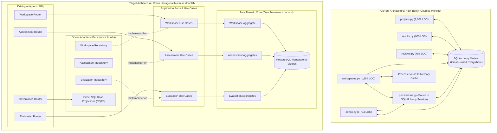

# NexaVault — Phase 0: Dependency & Architecture Coupling Map

**Inspection Mode**: Code-level AST, Import Tracing & Runtime Structure  
**Date**: 2026-11-21  

---

## 1. Verified Architecture & Import Coupling Defects

### 1.1 Routes Directly Accessing and Modifying ORM Models
In standard layered or hexagonal architectures, route controllers only accept HTTP inputs, invoke application use cases, and format responses. In NexaVault:
* **100% of route files** in `backend/app/api/v1/endpoints/*.py` import SQLAlchemy ORM models directly (`from app.models.workspace import Workspace`, `from app.models.review import ResultEntry`, etc.).
* Controllers execute raw queries (`db.query(...)`), joins, group-bys, mutations (`db.add()`, `db.flush()`), and transaction commits (`db.commit()`).
* **Evidence**:
  * [workspaces.py:8](file:///d:/SEM_3/23AID204-A_DSA/PROJECT/NexaVault/backend/app/api/v1/endpoints/workspaces.py#L8): `from app.models.review import ReviewRound, Submission, SubmissionVersion, Review, ResultEntry`
  * [results.py:13](file:///d:/SEM_3/23AID204-A_DSA/PROJECT/NexaVault/backend/app/api/v1/endpoints/results.py#L13): `from app.models.review import ResultEntry, ReviewRound, ResultCorrection, Submission, SubmissionVersion, Review`
  * [admin.py:11-16](file:///d:/SEM_3/23AID204-A_DSA/PROJECT/NexaVault/backend/app/api/v1/endpoints/admin.py#L11-L16): imports almost every ORM entity in the system.

### 1.2 Business Logic Embedded Directly in Endpoints
* **Grade Calculation & Aggregation**: Located directly in [results.py:35-110](file:///d:/SEM_3/23AID204-A_DSA/PROJECT/NexaVault/backend/app/api/v1/endpoints/results.py#L35-L110) (`build_workspace_results`).
* **CSV Byte Generation with UTF-8 BOM**: Located directly in [results.py:115-155](file:///d:/SEM_3/23AID204-A_DSA/PROJECT/NexaVault/backend/app/api/v1/endpoints/results.py#L115-L155).
* **Roster Snapshot Compilation & Late Detection**: Located directly in [submissions.py:85-135](file:///d:/SEM_3/23AID204-A_DSA/PROJECT/NexaVault/backend/app/api/v1/endpoints/submissions.py#L85-L135).
* **Unique Join Code Generation**: Located directly in [groups.py:36-48](file:///d:/SEM_3/23AID204-A_DSA/PROJECT/NexaVault/backend/app/api/v1/endpoints/groups.py#L36-L48).

### 1.3 Cross-Domain Database Queries
Because entities maintain direct SQLAlchemy relationships across domains:
* `Workspace` has direct relationships to `projects`, `enrolled_groups`, `review_rounds`, and `notices`.
* Querying a workspace automatically pulls review rounds, submissions, and groups into the workspace session, preventing isolated domain boundaries.
* **Evidence**: In `workspaces.py:180-250`, loading the workspace list triggers queries across `review_rounds`, `projects`, and `workspace_notices` using eager joins.

### 1.4 Framework Dependencies Inside Domain Logic
* `app/core/permissions.py` (which contains core domain authorization rules like `can_create_project`, `can_submit_to_round`, `can_manage_round`) depends directly on `sqlalchemy.orm.Session` and SQLAlchemy ORM models:
  ```python
  from sqlalchemy.orm import Session
  from app.models.group import Group, GroupMembership
  from app.models.workspace import Workspace, WorkspaceGroup, WorkspaceStaff
  from app.models.project import Project
  from app.models.review import ReviewRound
  ```
* Pure domain rules cannot be unit tested without initializing a database session or SQLite mock.

### 1.5 Shared Mutable State & In-Process Cache Hazards
* In [app/core/cache.py:26-59](file:///d:/SEM_3/23AID204-A_DSA/PROJECT/NexaVault/backend/app/core/cache.py#L26-L59), `InMemoryCache` stores cache items in a global, process-local `OrderedDict` (`self._store`).
* **Cache Inconsistency**: In multi-worker Uvicorn configurations, each worker has an isolated cache instance. When Worker A invalidates `key_review_queue`, Worker B's memory is untouched and serves stale review queues.
* **CPU & Memory Overhead**: In `cache.py:94`, every cache hit calls `copy.deepcopy(entry.value)` to prevent in-place mutation, degrading throughput on large payloads.

### 1.6 Frontend Coupling & Missing Declarative Router
* **No Client Router**: `frontend/package.json` contains no routing library. Routing relies on manual string manipulation:
  `window.location.hash.replace(/^#\/?/, '')` in [StaffDashboard.jsx:32](file:///d:/SEM_3/23AID204-A_DSA/PROJECT/NexaVault/frontend/src/pages/Staff/StaffDashboard.jsx#L32).
* **DOM Retained State**: `StaffDashboard.jsx:133-203` keeps all visited views mounted (`className={activeTab === tab ? 'block' : 'hidden'}`), leading to unmanaged memory growth and stale state when switching tabs.
* **API Error Handling**: `frontend/src/api/client.js` does not intercept 401 Unauthorized responses to clear `localStorage` or trigger logout, causing users to encounter silent failures upon token expiration.

---

## 2. Mermaid Coupling Diagram: Current vs. Target


