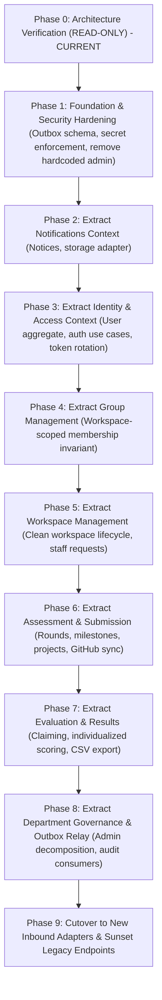

# NexaVault — Phase 0: Incremental Migration Plan

**Strategy**: Strangler Fig Pattern within a Modular Monolith  
**Zero-Downtime Guarantee**: Legacy API endpoints remain functional until each extracted context passes 100% regression tests.  
**Date**: 2026-11-21  

---

## 1. Migration Phasing & Extraction Sequence

The migration decomposes the application into hexagonal bounded contexts incrementally from lowest dependencies to highest.

---

## 2. Detailed Phase Specifications

### Phase 1: Foundation & Security Hardening
* **Prerequisites**: Phase 0 sign-off.
* **Actions**:
  1. **Remove Hardcoded Administrator Credentials**: Remove auto-provisioning with hardcoded passwords in `app/main.py:85-138` and Alembic migration `h8i9j0k1l2m3`. Administrator provisioning must read from environment variables (`INITIAL_ADMIN_EMAIL`, `INITIAL_ADMIN_PASSWORD`).
  2. **Enforce Environment Secrets**: In `app/core/config.py`, fail startup if `JWT_SECRET` is unset or equals the development fallback string in production.
  3. **Create Transactional Outbox Schema**: Generate forward Alembic migration to add `outbox_events` and `idempotent_consumer_log` tables.
  4. **Create Shared Kernel**: Set up `src/shared/domain/` (Entity, AggregateRoot, DomainEvent, ValueObject) and `src/shared/application/ports/` (UnitOfWork, EventPublisher).
* **Rollback Plan**: Revert configuration check; downgrade the outbox Alembic migration.

### Phase 2: Extract Notifications Context
* **Why First**: Self-contained domain with minimal cross-entity dependencies.
* **Target Package**: `src/notifications/`
* **Components Extracted**:
  * Domain: `Notice` entity, 24-hour expiration rule.
  * Inbound Ports & Use Cases: `PublishNoticeUseCase`, `GetActiveNoticesQuery`, `DeleteNoticeUseCase`.
  * Outbound Ports: `NoticeRepositoryPort`, `ImageStoragePort`.
  * Adapters: `SQLAlchemyNoticeRepository`, `PillowImageStorageAdapter` (refactored from `storage_service.py`).
  * Inbound Adapter: `NoticeRouter` mounted under `/api/v1/workspaces/{id}/notices`.
* **Database Dependency**: None (reads existing `workspace_notices` table).
* **Regression Tests**: `backend/tests/test_notice_board.py` (all 8 tests must pass).

### Phase 3: Extract Identity & Access Context
* **Target Package**: `src/identity/`
* **Components Extracted**:
  * Domain: `User` aggregate root, password validation (reject silent truncation), role invariants.
  * Application: `RegisterStudentUseCase`, `AuthenticateUserUseCase`, `RefreshTokenUseCase`.
  * Adapters: `BcryptPasswordHasherAdapter`, `PyJWTTokenProviderAdapter`, `SQLAlchemyUserRepository`.
  * Inbound Adapter: `AuthRouter` mounted under `/api/v1/auth`.
* **API Contracts Preserved**: `POST /auth/register`, `POST /auth/login`, `GET /auth/me`. Response JSON shapes remain identical.
* **Regression Tests**: `backend/tests/test_admin_auth_and_rbac.py` (authentication and token validation tests).

### Phase 4: Extract Group Management Context
* **Target Package**: `src/group/`
* **Components Extracted**:
  * Domain: `StudentGroup` aggregate root, `JoinCode` value object, leadership transfer policy, orphan group deletion.
  * Application: `CreateGroupUseCase`, `JoinGroupByCodeUseCase`, `LeaveGroupUseCase`, `EnrollGroupUseCase`.
  * Adapters: `SQLAlchemyGroupRepository`.
  * Inbound Adapter: `GroupRouter` mounted under `/api/v1/groups`.
* **Database Migration**: Drop global unique constraint on `group_memberships.user_id`; add `workspace_id` to enable multi-course teams.
* **Regression Tests**: `backend/tests/test_staff_groups_projects_workflow.py`, `backend/tests/test_complete_application_e2e.py`.

### Phase 5: Extract Workspace Management Context
* **Target Package**: `src/workspace/`
* **Components Extracted**:
  * Domain: `Workspace` aggregate root, `WorkspaceStaff` entity, co-staff assignment invariants.
  * Application: `CreateWorkspaceUseCase`, `ArchiveWorkspaceUseCase`, `AssignCoStaffUseCase`, `RequestStaffAccessUseCase`.
  * Adapters: `SQLAlchemyWorkspaceRepository`.
  * Inbound Adapter: `WorkspaceRouter` mounted under `/api/v1/workspaces`.
* **De-bloat Achievement**: Strips notices and review rounds out of `workspaces.py`, reducing file size from 1,864 lines to a clean ~200-line router.
* **Regression Tests**: `backend/tests/test_workspace_results_and_feedback_workflow.py`.

### Phase 6: Extract Assessment & Submission Context
* **Target Package**: `src/assessment/`
* **Components Extracted**:
  * Domain: `ReviewRound` aggregate, `Project` aggregate, `Submission` aggregate with `roster_snapshot` freezing.
  * Application: `CreateReviewRoundUseCase`, `SubmitDeliverableUseCase`, `SyncGitHubCommitsUseCase`.
  * Adapters: `SQLAlchemyAssessmentRepository`, `HTTPXGitHubAdapter`.
  * Inbound Adapters: `RoundRouter`, `ProjectRouter`, `SubmissionRouter`.
* **Regression Tests**: `backend/tests/test_review_round_pipeline.py`, `backend/tests/test_projects_optimization.py`.

### Phase 7: Extract Evaluation & Results Context
* **Target Package**: `src/evaluation/`
* **Components Extracted**:
  * Domain: `Review` aggregate root, `ResultEntry` score bounds validation, `ResultCorrection` mandatory justification.
  * Application: `ClaimSubmissionUseCase` (with `SELECT ... FOR UPDATE`), `EvaluateSubmissionUseCase`, `ReleaseResultsUseCase`, `CorrectGradeUseCase`.
  * Query Projections: `WorkspaceResultsProjection` (fast SQL aggregation), `UniversalCSVExporter`.
  * Inbound Adapters: `ReviewRouter`, `ResultRouter`.
* **Regression Tests**: `backend/tests/test_results_section.py`, `backend/tests/test_results_publication_workflow.py`, `backend/tests/test_staff_progress_and_review_workflow.py`.

### Phase 8: Extract Department Governance & Outbox Relay
* **Target Package**: `src/governance/` & `src/audit/`
* **Components Extracted**:
  * Domain: `Department` tenant isolation rules, fail-closed access policies.
  * Application: `GetDepartmentDashboardQuery`, `ListDepartmentWorkspacesQuery`, `OutboxRelayService`.
  * Audit Consumer: Subscribes to domain events emitted to `outbox_events` and records append-only logs.
* **De-bloat Achievement**: Completely eliminates `app/api/v1/endpoints/admin.py` (1,724 lines) by delegating to clean governance queries and domain ports.
* **Regression Tests**: `backend/tests/test_administrator_role.py`, `backend/tests/test_audit_activity_center.py`.

### Phase 9: Route Cutover & Legacy Sunset
* **Action**:
  1. Point `app/api/v1/router.py` to the new inbound routers in `src/*/entrypoints/http/`.
  2. Run the complete automated test suite (132 tests) against the new routes.
  3. Safely archive and remove the 10 legacy controller files in `app/api/v1/endpoints/`.

---

## 3. Existing API Contracts to Preserve (100% Backwards Compatibility)

The following HTTP endpoints, methods, request bodies, and response schemas must be preserved exactly:

* **Authentication**: `POST /auth/register`, `POST /auth/login`, `GET /auth/me`
* **Groups**: `POST /groups/`, `GET /groups/me`, `GET /groups/{id}`, `POST /groups/join`, `PATCH /groups/{id}/code`, `POST /groups/{id}/leave`, `POST /groups/{id}/enroll`, `GET /workspaces/{id}/groups`
* **Workspaces**: `POST /workspaces/`, `GET /workspaces/`, `GET /workspaces/{id}`, `POST /workspaces/{id}/archive`, `POST /workspaces/{id}/costaff/{uid}`, `DELETE /workspaces/{id}/costaff/{uid}`
* **Rounds**: `POST /workspaces/{id}/rounds`, `GET /workspaces/{id}/rounds`, `PATCH /workspaces/{id}/rounds/{rid}`, `POST /workspaces/{id}/rounds/{rid}/toggle`, `DELETE /workspaces/{id}/rounds/{rid}`
* **Notices**: `GET /workspaces/{id}/notices`, `POST /workspaces/{id}/notices`, `DELETE /workspaces/{id}/notices/{nid}`, `POST /workspaces/{id}/notices/{nid}/pin`, `GET /workspaces/notices/images/{filename}`
* **Projects**: `POST /projects/`, `GET /projects/{id}`, `POST /projects/{id}/updates`, `GET /projects/{id}/github`, `POST /projects/{id}/github/sync`
* **Submissions**: `GET /projects/{id}/submissions`, `POST /projects/{id}/rounds/{rid}/submissions`, `POST /submissions/{id}/submit`
* **Reviews & Results**: `GET /reviews/queue`, `POST /reviews/{vid}/claim`, `POST /reviews/{vid}/evaluate`, `POST /reviews/{vid}/release-results`, `GET /results/workspace/{id}`, `GET /results/workspace/{id}/export-csv`, `GET /results/me`, `PATCH /results/{id}/correct`
* **Admin**: `GET /admin/dashboard`, `GET /admin/workspaces`, `GET /admin/staff`, `GET /admin/students`, `PATCH /admin/users/{id}/status`, `POST /admin/provision`
* **Audit**: `GET /audit/activity`, `GET /audit/stats`, `GET /audit/filters`
