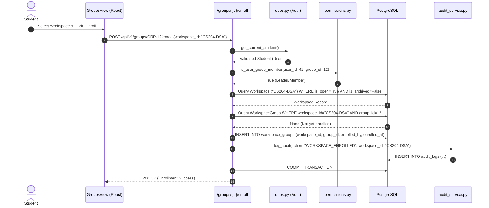
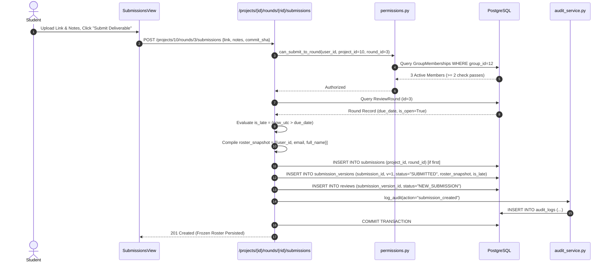
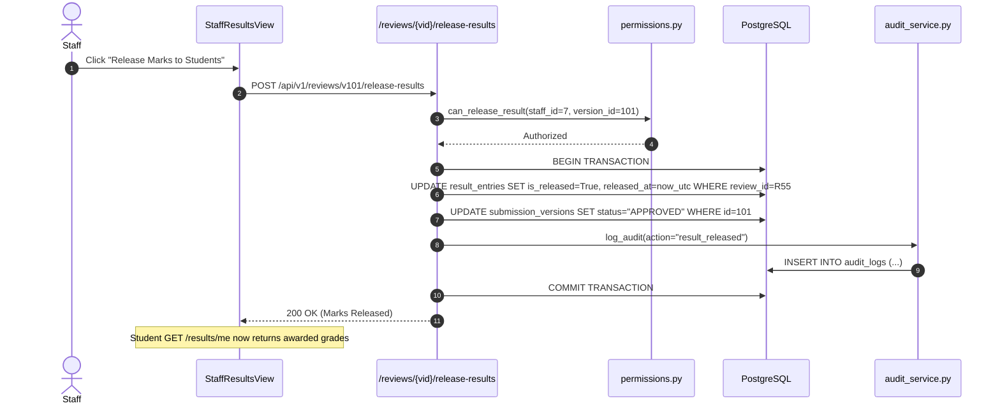
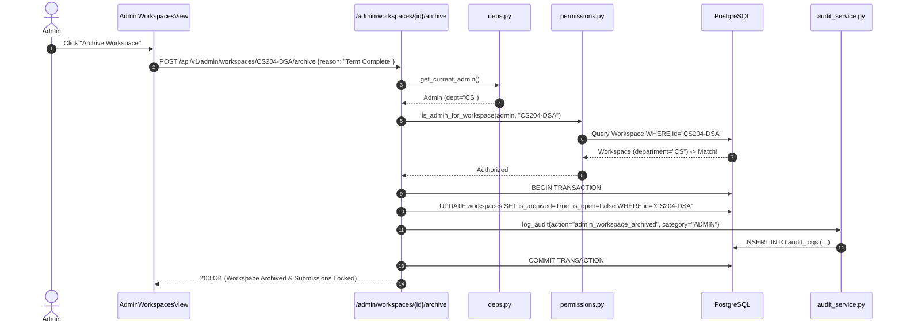

# NexaVault — Phase 0: Verified End-to-End Workflow Map

**Trace Scope**: Frontend UI Component $\to$ API Client $\to$ HTTP Route $\to$ Controller $\to$ Database & Audit  
**Date**: 2026-11-21  

---

## 1. Verified Student Workflows

### 1.1 Student Registration
* **Frontend Component**: `frontend/src/pages/Login/Login.jsx` (`handleRegister`)
* **API Client**: `authApi.register(email, password, fullName, role)` in `frontend/src/api/authApi.js:4-16`
* **HTTP Route**: `POST /api/v1/auth/register`
* **FastAPI Endpoint**: `app/api/v1/endpoints/auth.py:11` (`register_student`)
* **Dependencies & Auth**: Public endpoint (no auth token required); validates `UserCreate` Pydantic schema.
* **Business Logic**: Strips email, checks existing email, forces `role="student"`, hashes password via direct bcrypt (`app/core/security.py:14`), flushes DB.
* **Models Touched**: Inserts `User` (`app/models/user.py:13`), inserts `AuditLog` (`app/models/audit.py:17`).
* **Transaction Behavior**: `db.add(db_user); db.flush(); log_audit(...); db.commit(); db.refresh(db_user)`. Single atomic commit.
* **Audit Event**: `USER_REGISTERED` (Category: `SECURITY`, Status: `SUCCESS`).
* **Events / Notifications**: None (procedural).
* **Relevant Tests**: `backend/tests/test_admin_auth_and_rbac.py:test_public_registration_forces_student_role`.

### 1.2 Student Login
* **Frontend Component**: `frontend/src/pages/Login/Login.jsx` (`handleLogin`)
* **API Client**: `authApi.login(email, password)` in `frontend/src/api/authApi.js:18-29`
* **HTTP Route**: `POST /api/v1/auth/login`
* **FastAPI Endpoint**: `app/api/v1/endpoints/auth.py:71` (`login_user`)
* **Dependencies & Auth**: Public endpoint; checks credentials.
* **Business Logic**: Queries `User` by lowercase email, verifies bcrypt hash via `verify_password()`, checks `user.is_active`, signs JWT via `create_access_token()` with 24h expiration (`ACCESS_TOKEN_EXPIRE_MINUTES = 1440`).
* **Models Touched**: Queries `User`, inserts `AuditLog`.
* **Transaction Behavior**: Commits audit entry (`USER_LOGIN_SUCCESS` or `USER_LOGIN_FAILED`) and returns JWT token string.
* **Audit Event**: `USER_LOGIN_SUCCESS` (or `USER_LOGIN_FAILED`).
* **Events / Notifications**: None.
* **Relevant Tests**: `backend/tests/test_admin_auth_and_rbac.py:test_admin_authentication_and_password_verification`.

### 1.3 Group Creation
* **Frontend Component**: `frontend/src/pages/Student/GroupsView.jsx` (`handleCreateGroup`)
* **API Client**: `groupApi.createGroup({ name })` in `frontend/src/api/groupApi.js:4-8`
* **HTTP Route**: `POST /api/v1/groups/`
* **FastAPI Endpoint**: `app/api/v1/endpoints/groups.py:53` (`create_group`)
* **Dependencies & Auth**: `get_current_student` (`app/api/deps.py:83`) requiring `role == "student"`.
* **Business Logic**: Checks `get_user_active_group()`: if user already belongs to an active group, rejects with 400. Generates 7-character alphanumeric code via `generate_unique_alphanumeric_code()`. Creates `Group` and auto-adds creator to `GroupMembership`.
* **Models Touched**: Inserts `Group`, inserts `GroupMembership`, inserts `AuditLog`.
* **Transaction Behavior**: `db.add(group); db.flush(); db.add(membership); log_audit(...); db.commit()`. Single atomic transaction.
* **Audit Event**: `GROUP_CREATED` (Category: `ACCESS`).
* **Events / Notifications**: In-memory cache invalidated via `invalidate_group()`.
* **Relevant Tests**: `backend/tests/test_complete_application_e2e.py`, `backend/tests/test_staff_groups_projects_workflow.py`.

### 1.4 Joining a Group via Join Code
* **Frontend Component**: `frontend/src/pages/Student/GroupsView.jsx` (`handleJoinGroup`)
* **API Client**: `groupApi.joinGroup({ code })` in `frontend/src/api/groupApi.js:10-14`
* **HTTP Route**: `POST /api/v1/groups/join`
* **FastAPI Endpoint**: `app/api/v1/endpoints/groups.py:114` (`join_group_by_code`)
* **Dependencies & Auth**: `get_current_student`.
* **Business Logic**: Verifies student has no active group. Matches uppercase code against non-deleted groups. Enforces unique constraint on `group_memberships.user_id`.
* **Models Touched**: Inserts `GroupMembership`, inserts `AuditLog`.
* **Transaction Behavior**: Atomic `db.commit()`.
* **Audit Event**: `MEMBER_JOINED` (Category: `ACCESS`).
* **Events / Notifications**: Cache invalidated for user and group.
* **Relevant Tests**: `backend/tests/test_complete_application_e2e.py`.

### 1.5 Workspace Curriculum Enrollment
* **Frontend Component**: `frontend/src/pages/Student/WorkspacesView.jsx` (`handleEnrollGroup`)
* **API Client**: `groupApi.enrollGroup(groupId, workspaceId)` in `frontend/src/api/groupApi.js:25-30`
* **HTTP Route**: `POST /api/v1/groups/{group_id}/enroll`
* **FastAPI Endpoint**: `app/api/v1/endpoints/groups.py:279` (`enroll_group_in_workspace`)
* **Dependencies & Auth**: `get_current_student`.
* **Business Logic**: Verifies caller is member of `group_id`. Verifies workspace exists, is not archived, and `is_open == True`. Checks if group is already enrolled in workspace (`WorkspaceGroup`). If not, creates enrollment.
* **Models Touched**: Queries `Workspace`, `Group`, inserts `WorkspaceGroup`, inserts `AuditLog`.
* **Transaction Behavior**: Atomic commit.
* **Audit Event**: `WORKSPACE_ENROLLED` (Category: `WORKSPACE`).
* **Events / Notifications**: Invalidation of workspace and group caches.
* **Relevant Tests**: `backend/tests/test_complete_application_e2e.py`.

### 1.6 Project Creation
* **Frontend Component**: `frontend/src/pages/Student/ProjectsView.jsx` (`handleCreateProject`)
* **API Client**: `projectApi.createProject(payload)` in `frontend/src/api/projectApi.js:4-8`
* **HTTP Route**: `POST /api/v1/projects/`
* **FastAPI Endpoint**: `app/api/v1/endpoints/projects.py:96` (`create_project`)
* **Dependencies & Auth**: `get_current_user`.
* **Business Logic**: Evaluates `can_create_project()` in `app/core/permissions.py:136`:
  1. Student has active group.
  2. Group has **at least 2 members** (`member_count >= 2`).
  3. Group is enrolled in workspace.
  4. Group does not already have a project in this workspace (`UniqueConstraint("workspace_id", "group_id")`).
  5. Workspace is active and open.
* **Models Touched**: Inserts `Project`, inserts `AuditLog`.
* **Transaction Behavior**: Atomic commit.
* **Audit Event**: `PROJECT_CREATED` (Category: `PROJECT`).
* **Events / Notifications**: Invalidation of workspace and group caches.
* **Relevant Tests**: `backend/tests/test_staff_groups_projects_workflow.py`.

### 1.7 Milestone Deliverable Submission
* **Frontend Component**: `frontend/src/pages/Student/SubmissionsView.jsx` (`handleSubmitDeliverable`)
* **API Client**: `submissionApi.submitDeliverable(projectId, roundId, payload)` in `frontend/src/api/submissionApi.js:4-10`
* **HTTP Route**: `POST /api/v1/projects/{project_id}/rounds/{round_id}/submissions`
* **FastAPI Endpoint**: `app/api/v1/endpoints/submissions.py:51` (`create_or_version_submission`)
* **Dependencies & Auth**: `get_current_student`.
* **Business Logic**: Evaluates `can_submit_to_round()` (`app/core/permissions.py:178`). Checks group size $\ge 2$, open round, active workspace. Creates `Submission` (if first time) or increments `version_number`. Checks if `now_utc > round.due_date` $\to$ sets `is_late = True`. **Freezes immutable roster snapshot** of all current group members into `roster_snapshot` JSON column. Sets version status to `SUBMITTED`. Creates initial `Review` container.
* **Models Touched**: `Submission`, `SubmissionVersion`, `Review`, `AuditLog`.
* **Transaction Behavior**: `db.commit()` in single transaction.
* **Audit Event**: `submission_created` (Category: `ASSESSMENT`).
* **Events / Notifications**: Invalidation of project and review queue cache.
* **Relevant Tests**: `backend/tests/test_review_round_pipeline.py`, `backend/tests/test_complete_application_e2e.py`.

### 1.8 Viewing Released Results
* **Frontend Component**: `frontend/src/pages/Student/ResultsView.jsx` (`fetchResults`)
* **API Client**: `resultApi.getMyResults()` in `frontend/src/api/resultApi.js:4-8`
* **HTTP Route**: `GET /api/v1/results/me`
* **FastAPI Endpoint**: `app/api/v1/endpoints/results.py:157` (`get_my_results`)
* **Dependencies & Auth**: `get_current_student`.
* **Business Logic**: Queries `ResultEntry` where `student_id == current_user.id` AND `is_released == True`. Unreleased marks are strictly filtered out at query level.
* **Models Touched**: Read query on `ResultEntry`, `ReviewRound`, `Workspace`.
* **Transaction Behavior**: Read-only query.
* **Audit Event**: None.
* **Relevant Tests**: `backend/tests/test_results_section.py`.

---

## 2. Verified Staff Workflows

### 2.1 Workspace Creation
* **Frontend Component**: `frontend/src/pages/Staff/StaffWorkspacesView.jsx` (`handleCreateWorkspace`)
* **API Client**: `workspaceApi.createWorkspace(payload)` in `frontend/src/api/workspaceApi.js:4-8`
* **HTTP Route**: `POST /api/v1/workspaces/`
* **FastAPI Endpoint**: `app/api/v1/endpoints/workspaces.py:71` (`create_workspace`)
* **Dependencies & Auth**: `get_current_staff` (`deps.py:94`) requiring `role in ["staff", "teacher"]`.
* **Business Logic**: Validates title/name, generates or verifies unique custom workspace ID (e.g. `CS204-DSA`), sets creator as `owner_id`, automatically inserts owner into `workspace_staff` with `role="owner"`.
* **Models Touched**: Inserts `Workspace`, inserts `WorkspaceStaff`, inserts `AuditLog`.
* **Transaction Behavior**: Atomic `db.commit()`.
* **Audit Event**: `workspace_created` (Category: `WORKSPACE`).
* **Events / Notifications**: Cache prefix `ws:list:` invalidated.
* **Relevant Tests**: `backend/tests/test_workspace_results_and_feedback_workflow.py`.

### 2.2 Review Round Pipeline Configuration
* **Frontend Component**: `frontend/src/pages/Staff/StaffWorkspacesView.jsx` (`handleSaveRound`)
* **API Client**: `workspaceApi.createReviewRound(wsId, payload)` in `frontend/src/api/workspaceApi.js:20-25`
* **HTTP Route**: `POST /api/v1/workspaces/{workspace_id}/rounds`
* **FastAPI Endpoint**: `app/api/v1/endpoints/workspaces.py:1255` (`create_review_round`)
* **Dependencies & Auth**: `get_current_staff`, `can_manage_round()` (`app/core/permissions.py:257`).
* **Business Logic**: Checks `max_score >= 1.0`, parses ISO due date, assigns sequential `order_index`, persists default weight (20.0%).
* **Models Touched**: Inserts `ReviewRound`, inserts `AuditLog`.
* **Transaction Behavior**: Atomic commit.
* **Audit Event**: `round_created` (Category: `ASSESSMENT`).
* **Events / Notifications**: Invalidates round cache.
* **Relevant Tests**: `backend/tests/test_review_round_pipeline.py`.

### 2.3 Review Queue & Submission Claiming (Row-Level Locking)
* **Frontend Component**: `frontend/src/pages/Staff/StaffReviewQueueView.jsx` (`handleClaim`)
* **API Client**: `reviewApi.claimSubmission(versionId)` in `frontend/src/api/reviewApi.js:4-8`
* **HTTP Route**: `POST /api/v1/reviews/{version_id}/claim`
* **FastAPI Endpoint**: `app/api/v1/endpoints/reviews.py:126` (`claim_submission`)
* **Dependencies & Auth**: `get_current_staff`, `can_review_submission()` (`app/core/permissions.py:261`).
* **Business Logic**:
  1. Issues `db.query(SubmissionVersion).filter(...).with_for_update().first()` — **pessimistic PostgreSQL row lock**.
  2. Verifies `claimed_by_id` is null or matches current staff.
  3. Updates `claimed_by_id = staff.id`, `status = "IN_REVIEW"`, `review.claimed_at = now()`.
* **Models Touched**: Updates `SubmissionVersion`, updates `Review`, inserts `AuditLog`.
* **Transaction Behavior**: Row lock held until atomic `db.commit()`.
* **Audit Event**: `submission_claimed` (Category: `ASSESSMENT`).
* **Events / Notifications**: Review queue cache invalidated.
* **Relevant Tests**: `backend/tests/test_staff_progress_and_review_workflow.py`.

### 2.4 Individual Student Evaluation & Scoring
* **Frontend Component**: `frontend/src/pages/Staff/StaffReviewQueueView.jsx` (`handleSubmitEvaluation`)
* **API Client**: `reviewApi.evaluateSubmission(versionId, payload)` in `frontend/src/api/reviewApi.js:12-16`
* **HTTP Route**: `POST /api/v1/reviews/{version_id}/evaluate`
* **FastAPI Endpoint**: `app/api/v1/endpoints/reviews.py:214` (`evaluate_submission`)
* **Dependencies & Auth**: `get_current_staff`; verifies `version.claimed_by_id == staff.id`.
* **Business Logic**:
  1. Loads `version.roster_snapshot`.
  2. Iterates each student in payload, validating $0 \le \text{score} \le \text{round.max\_score}$.
  3. Verifies that **every student present in the frozen roster receives an individual score**.
  4. Inserts or updates `ResultEntry` with `is_released = False`.
  5. Updates `Review.status = "COMPLETED"`, `Review.feedback`, `Review.completed_at`.
* **Models Touched**: `ResultEntry` (multiple), `Review`, `SubmissionVersion`, `AuditLog`.
* **Transaction Behavior**: Single atomic `db.commit()` ensuring all individual student marks and the review header persist together.
* **Audit Event**: `review_submitted` (Category: `ASSESSMENT`).
* **Events / Notifications**: Results cache invalidated.
* **Relevant Tests**: `backend/tests/test_results_section.py`, `backend/tests/test_results_publication_workflow.py`.

### 2.5 Releasing Results to Students
* **Frontend Component**: `frontend/src/pages/Staff/StaffResultsView.jsx` (`handleReleaseResults`)
* **API Client**: `reviewApi.releaseResults(versionId)` in `frontend/src/api/reviewApi.js:18-22`
* **HTTP Route**: `POST /api/v1/reviews/{version_id}/release-results`
* **FastAPI Endpoint**: `app/api/v1/endpoints/reviews.py:341` (`release_results`)
* **Dependencies & Auth**: `get_current_staff`, `can_release_result()`.
* **Business Logic**: Queries all `ResultEntry` rows attached to this review, updates `is_released = True`, `released_at = now_utc`. Updates `version.status = "APPROVED"`.
* **Models Touched**: `ResultEntry`, `SubmissionVersion`, `AuditLog`.
* **Transaction Behavior**: Atomic `db.commit()`.
* **Audit Event**: `result_released` (Category: `ASSESSMENT`).
* **Events / Notifications**: Results cache invalidated across all student sessions.
* **Relevant Tests**: `backend/tests/test_results_publication_workflow.py`.

### 2.6 Grade Correction with Mandatory Justification
* **Frontend Component**: `frontend/src/pages/Staff/StaffResultCorrectionModal.jsx` (`handleSaveCorrection`)
* **API Client**: `resultApi.correctResult(entryId, payload)` in `frontend/src/api/resultApi.js:20-25`
* **HTTP Route**: `PATCH /api/v1/results/{entry_id}/correct`
* **FastAPI Endpoint**: `app/api/v1/endpoints/results.py:461` (`correct_result_entry`)
* **Dependencies & Auth**: `get_current_staff`, `can_correct_result()` (`app/core/permissions.py:282`).
* **Business Logic**: Validates `new_score` against `round.max_score`. Enforces non-empty `reason` string. Inserts `ResultCorrection` recording `old_score`, `new_score`, `reason`, and `corrected_by_id`. Updates `ResultEntry.score`.
* **Models Touched**: `ResultEntry`, `ResultCorrection`, `AuditLog`.
* **Transaction Behavior**: Atomic commit of score change and correction log.
* **Audit Event**: `result_corrected` (Category: `ASSESSMENT`).
* **Events / Notifications**: Results cache invalidated.
* **Relevant Tests**: `backend/tests/test_results_section.py`.

---

## 3. Verified Administrator Workflows

### 3.1 Department Administrator Dashboard
* **Frontend Component**: `frontend/src/pages/Admin/AdminDashboardView.jsx` (`loadDashboardStats`)
* **API Client**: `adminApi.getDashboard()` in `frontend/src/api/adminApi.js:4-8`
* **HTTP Route**: `GET /api/v1/admin/dashboard`
* **FastAPI Endpoint**: `app/api/v1/endpoints/admin.py:227` (`get_admin_dashboard`)
* **Dependencies & Auth**: `get_current_admin` (`deps.py:123`) requiring `role == "administrator"`.
* **Business Logic**: Resolves accessible workspace IDs via `get_admin_workspace_ids()`. Executes SQL count aggregations for total/active/archived workspaces, department staff, enrolled students, active projects, and open review rounds.
* **Models Touched**: Read-only queries on `Workspace`, `User`, `WorkspaceGroup`, `GroupMembership`, `Project`, `ReviewRound`, `Submission`.
* **Transaction Behavior**: Read-only.
* **Audit Event**: None.
* **Relevant Tests**: `backend/tests/test_administrator_role.py:test_admin_dashboard_stats`.

### 3.2 Department Workspace Lifecycle & Staff Assignment
* **Frontend Component**: `frontend/src/pages/Admin/AdminWorkspacesView.jsx`
* **API Client**: `adminApi.assignStaff(wsId, userId)` / `archiveWorkspace(wsId)` in `frontend/src/api/adminApi.js`
* **HTTP Route**: `POST /api/v1/admin/workspaces/{id}/staff` / `POST /api/v1/admin/workspaces/{id}/archive`
* **FastAPI Endpoint**: `app/api/v1/endpoints/admin.py:650` (`assign_staff_to_workspace`) / `admin.py:530` (`archive_admin_workspace`)
* **Dependencies & Auth**: `get_current_admin`; checks `is_admin_for_workspace()`.
* **Business Logic**: Verifies target staff exists. Inserts `WorkspaceStaff` with `role="costaff"`. For archiving: toggles `is_archived = True`, invalidates cache.
* **Models Touched**: `WorkspaceStaff`, `Workspace`, `AuditLog`.
* **Transaction Behavior**: Atomic `db.commit()`.
* **Audit Event**: `admin_staff_assigned` / `admin_workspace_archived` (Category: `ADMIN`).
* **Events / Notifications**: Workspace cache invalidated.
* **Relevant Tests**: `backend/tests/test_administrator_role.py:test_admin_assign_and_remove_staff`.

### 3.3 User Active Status Management & Provisioning
* **Frontend Component**: `frontend/src/pages/Admin/AdminStudentsView.jsx` & `AdminStaffView.jsx`
* **API Client**: `adminApi.updateUserStatus(id, isActive)` / `adminApi.provisionUser(payload)`
* **HTTP Route**: `PATCH /api/v1/admin/users/{user_id}/status` / `POST /api/v1/admin/provision`
* **FastAPI Endpoint**: `app/api/v1/endpoints/admin.py:840` (`toggle_user_active_status`) / `admin.py:910` (`provision_user`)
* **Dependencies & Auth**: `get_current_admin`.
* **Business Logic**: Toggles `is_active`. For provisioning: verifies email does not exist, hashes password, sets `department = current_admin.department` (cannot elevate out of dept).
* **Models Touched**: `User`, `AuditLog`.
* **Transaction Behavior**: Atomic `db.commit()`.
* **Audit Event**: `admin_account_status_changed` / `admin_account_provisioned` (Category: `ADMIN`).
* **Events / Notifications**: Cache invalidated for user.
* **Relevant Tests**: `backend/tests/test_admin_auth_and_rbac.py:test_admin_provisioning_with_secret`.

---

## 4. Mermaid Sequence Diagrams for Core Critical Workflows

### 4.1 Group Enrollment Workflow


### 4.2 Submission Creation & Immutable Roster Freezing


### 4.3 Staff Review Queue & Pessimistic Claim Locking
```mermaid
sequenceDiagram
    autonumber
    actor Staff
    participant UI as StaffReviewQueueView
    participant API as /reviews/{vid}/claim
    participant Deps as deps.py
    participant DB as PostgreSQL (Row Lock)
    participant Audit as audit_service.py

    Staff->>UI: Click "Claim for Evaluation"
    UI->>API: POST /api/v1/reviews/v101/claim
    API->>Deps: get_current_staff()
    Deps-->>API: Validated Staff (User #7)
    API->>DB: BEGIN TRANSACTION
    API->>DB: SELECT * FROM submission_versions WHERE id=101 FOR UPDATE
    Note over DB: Row locked; concurrent claims blocked
    DB-->>API: Version Record (claimed_by_id=NULL)
    API->>DB: UPDATE submission_versions SET claimed_by_id=7, status="IN_REVIEW" WHERE id=101
    API->>DB: UPDATE reviews SET claimed_at=now_utc, reviewer_id=7 WHERE submission_version_id=101
    API->>Audit: log_audit(action="submission_claimed")
    Audit->>DB: INSERT INTO audit_logs (...)
    API->>DB: COMMIT TRANSACTION (Lock Released)
    API-->>UI: 200 OK (Claim Confirmed)
```

### 4.4 Individual Evaluation & Results Publication


### 4.5 Administrator Department Workspace Archival

